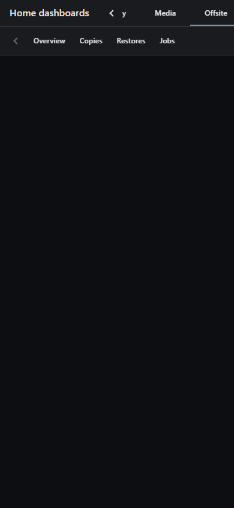
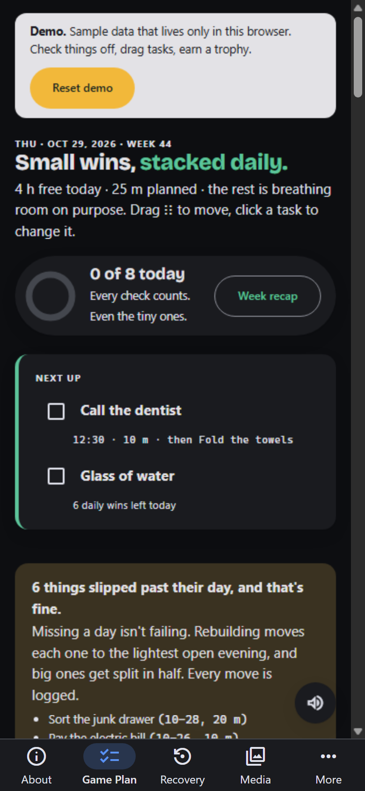
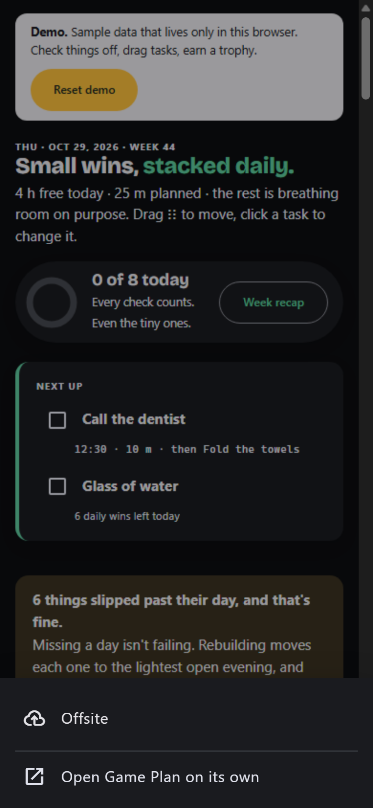

# Phone layout (2026-10-29)

The Pages demo on mock tabs, 390×844. Headless Chrome doesn't always finish loading the framed cross-site apps, so a frame can be blank.

| Before: the tab strip | After: bottom tab bar | After: More sheet |
|---|---|---|
|  |  |  |

## Phones (600px wide and under)
- **No top bar.** A fixed bottom tab bar shows the first four tabs and **More**. Each tab is an icon and a short label: the title, or its first word when the title is long. The current tab gets a filled icon on an accent pill.
- **More** opens a bottom sheet with the remaining tabs, "Open … on its own" (the ↗) and any status note. A dot on More means there's a note.
- **A tab under More:** while one is open, the More slot shows its icon and label as current.
- **The frame** fills the space between the safe-area top and the bar. An app's own fixed bottom UI (Sensitivity's verdict buttons, say) sits directly above the bar, never under it.
- **Swipe between tabs:** left out on purpose. Swipes inside the frame go to the app, and on a 56px bar they fight the system back gesture.

## Wider screens
- The top tab strip pages to the active tab once the tab list loads and after a resize or rotation.
- The ↗ is a 44×44 tap target.
- Notches and rounded corners stay clear (`viewport-fit=cover`, `env(safe-area-inset-*)`).

## Icons
Each tab row has an `icon`: a [Material Symbols](https://fonts.google.com/icons) name such as `photo_library`. Set it with `python -m app.cli set <id> --icon <name>`, or as `"icon"` in tabs.json. Empty shows `tab`. The app builds the font in from the `material-symbols` package. The Pages demo alone loads the same version from jsDelivr, because the font's bytes trip the public-repo guard.

Tested at 360, 390 and 414 portrait, 844×390 landscape (top strip), and 768.
