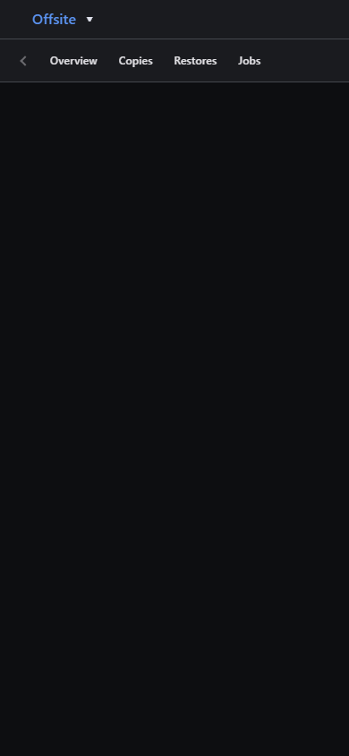

# Phone layout (2026-10-29)

The Pages demo on mock tabs, 390×844, with the Offsite tab open. The framed app is blank or partly loaded because headless Chrome doesn't always finish loading cross-site frames.

| Before | After |
|---|---|
|  |  |

## What changed
- **Under 600px wide**, the brand and the tab strip give way to one button with the active tab's name. It opens a menu of every tab, with the current one marked. Before, the strip showed about one and a half tabs, the active one could sit past the arrows, and the ↗ was pushed off the edge.
- **At every width**, the tab strip pages to the active tab once the tab list loads and after a resize or rotation. Material only does this on its own when the tabs exist at first layout.
- **The ↗ (open on its own)** is a 44×44 tap target with a 20px arrow and an aria-label.
- **The frame** fills the rest of `100dvh` and is the only thing that scrolls.
- **Notches and rounded corners:** the nav and the frame keep clear of them (`viewport-fit=cover` and `env(safe-area-inset-*)`).

Tested at 360, 390 and 414 portrait, 844×390 landscape, and 768.
