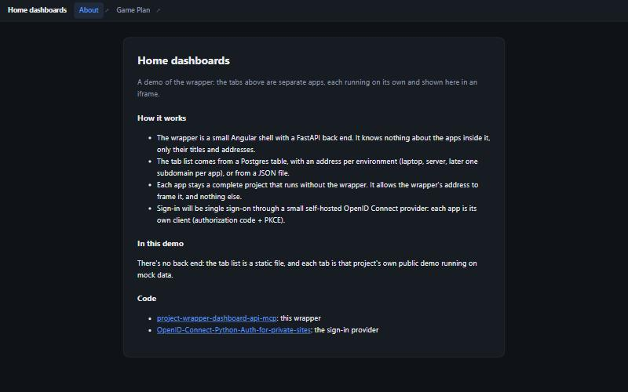
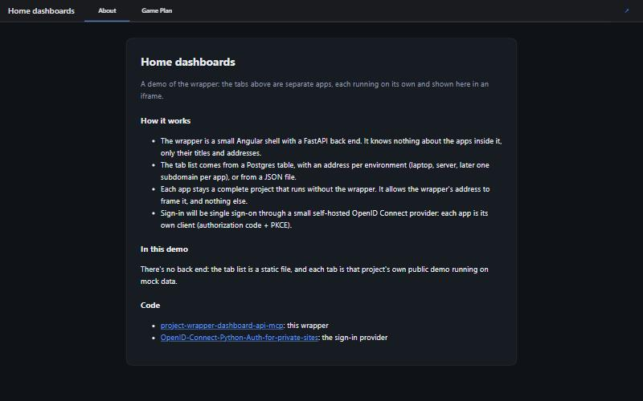
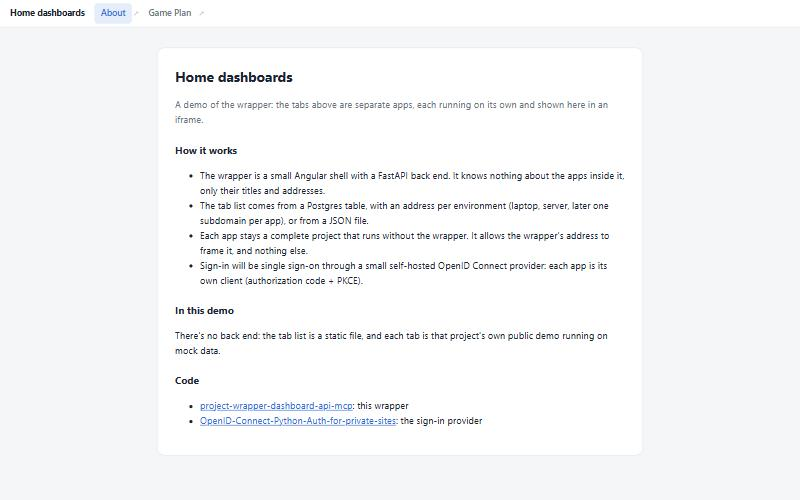
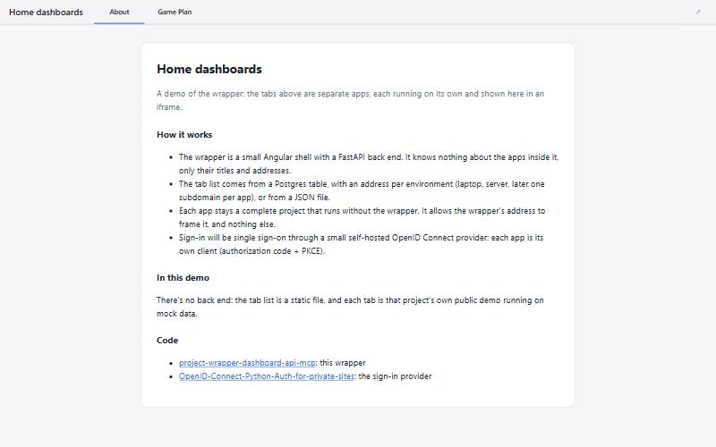
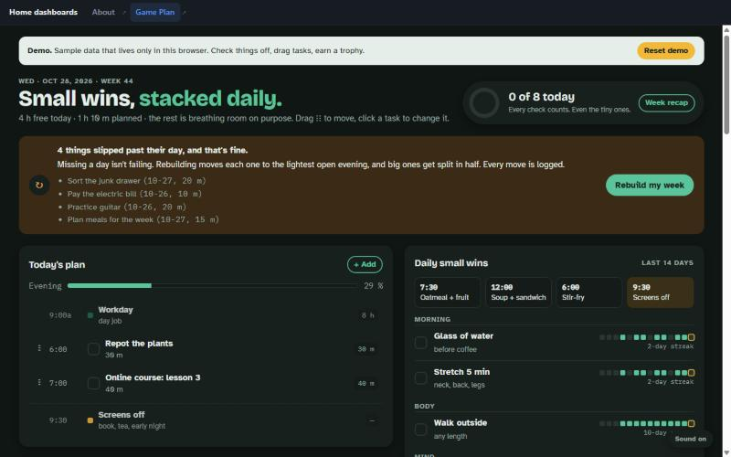
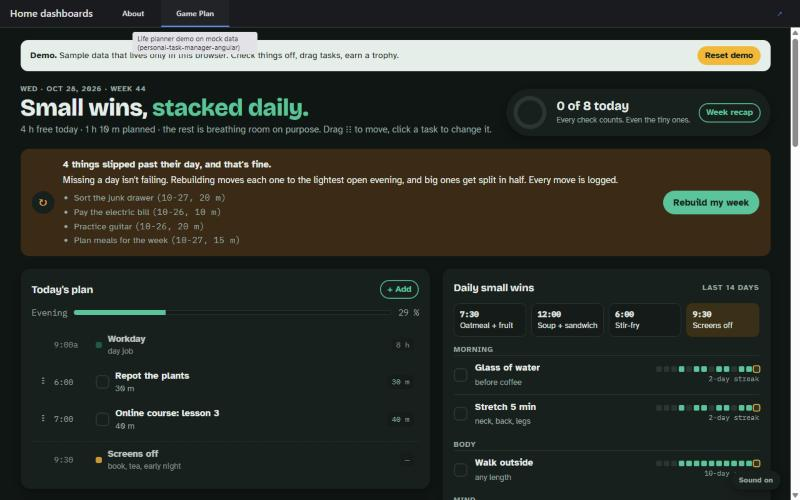

# Refactor to the shared template (branch refactor/template, 2026-10-29)

Same behavior and data. These are structure and library changes.

## Screens (demo build on mock data)
| | Before | After |
|---|---|---|
| About, dark |  |  |
| About, light |  |  |
| Game Plan tab, dark |  |  |

## Intentional visual changes
- The nav is Angular Material's tab bar (`mat-tab-nav-bar`): the active tab gets an underline instead of a tinted pill.
- Material tab links can't contain a second link, so the per-tab ↗ ("open on its own") is now **one ↗ button at the right of the nav** that opens the current tab.
- Colors, spacing and type come from the shared theme (`ui/src/styles/theme.scss`). Light and dark still follow the system.

## UI (ui/src/app)
```
core/      tabs.service.ts (tab list, polling), models.ts, api-types.ts (generated: npm run api-types)
shared/    empty-state/
features/  shell/nav-bar.*  (presentational: tabs in, no logic)
           tab-frame/tab-frame.page.ts  (route /:id, the iframe)
app.ts, app.routes.ts, app.config.ts
```
- Standalone, OnPush, signals, `input()`.
- The selector prefix is now `app` (the root is `<app-root>`).
- angular-eslint + Prettier.

## API (api/app)
```
main.py              create_app(): routers, CSP frame-ancestors middleware, lifespan migration
core/config.py       pydantic-settings, the only place env is read
api/routes/          config.py, tabs.py, health.py, ui.py (static shell + SPA fallback)
schemas/             tabs.py (Tab, TabList), config.py (AppConfig)
services/tabs.py     file or database tab source, upsert/remove
db/                  models.py (SQLAlchemy 2.0), session.py, migrations/ (Alembic; 0001 = tab + tab_url)
cli.py               python -m app.cli list|set|remove|import|migrate
openapi_export.py    writes openapi.json, which the UI types come from
tests/               pytest + httpx TestClient; test_db.py runs against a throwaway Postgres (TEST_DB_HOST)
```
- The package was renamed `wrapper` → `app`. The CLI is now `python -m app.cli`.
- `/openapi.json` is served, so the UI types can be generated from it.
